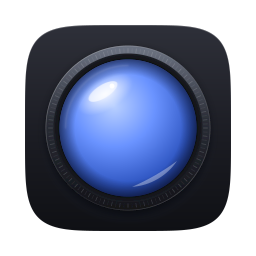
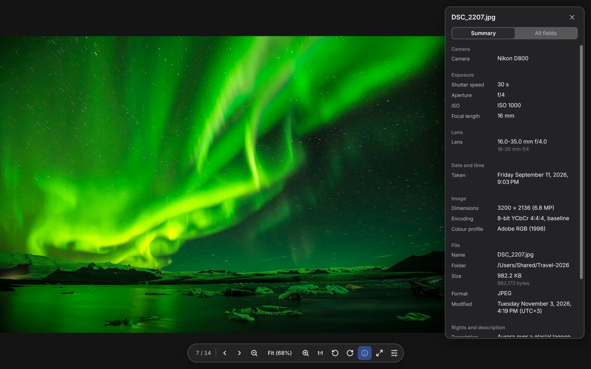
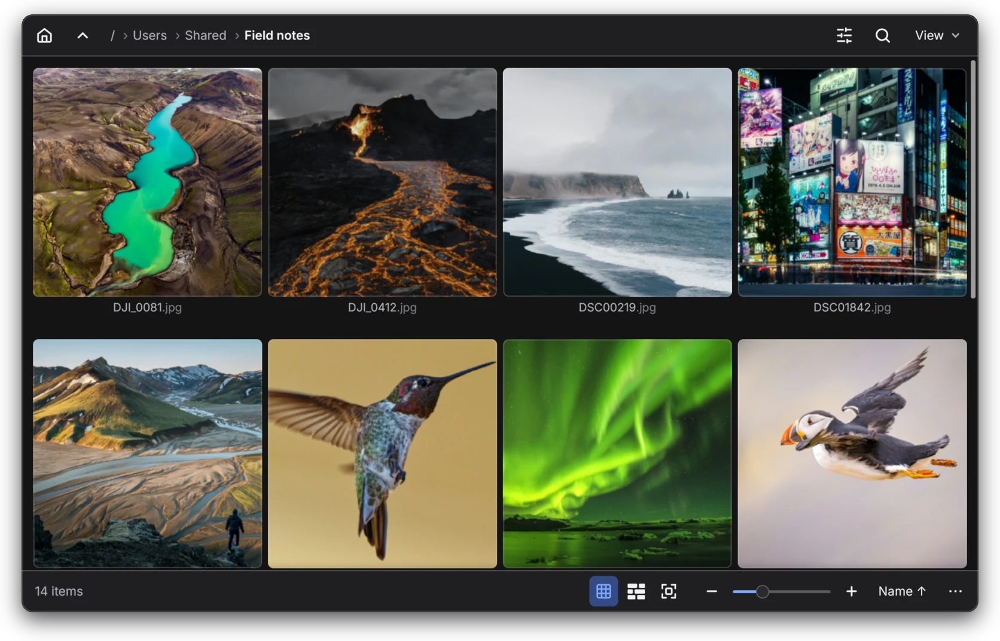
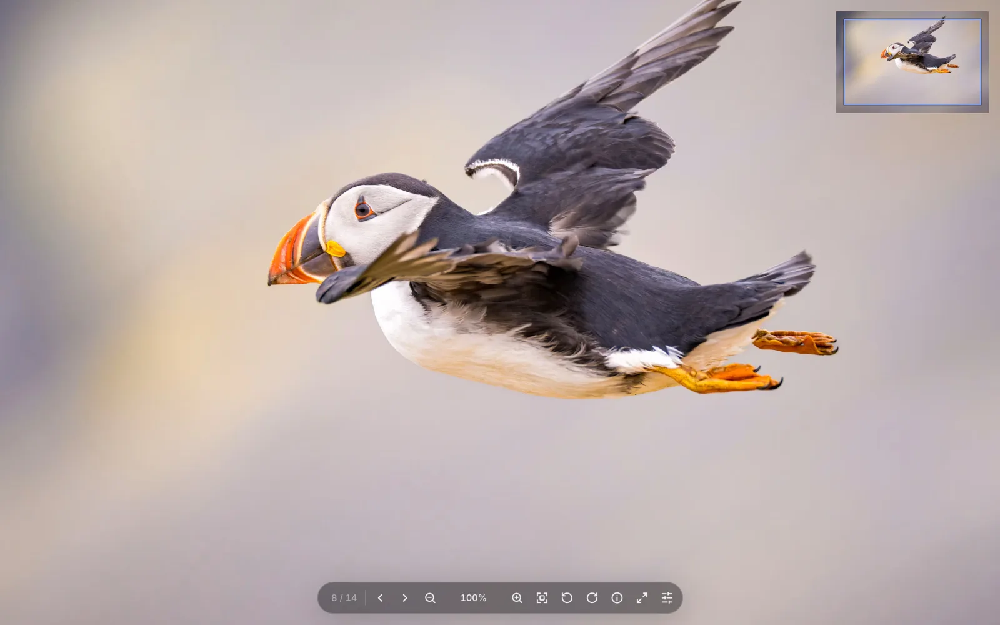
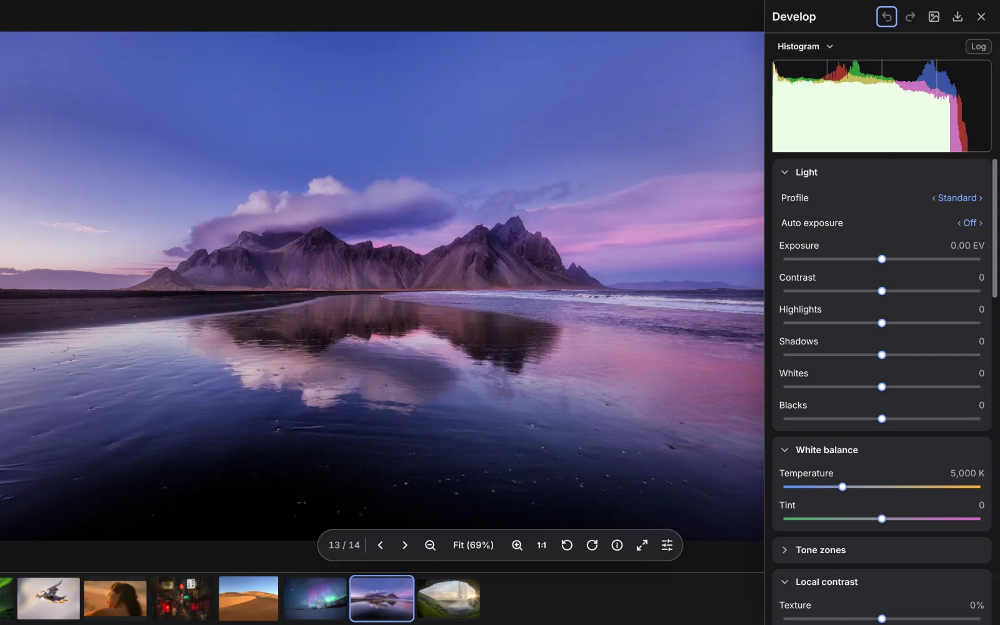
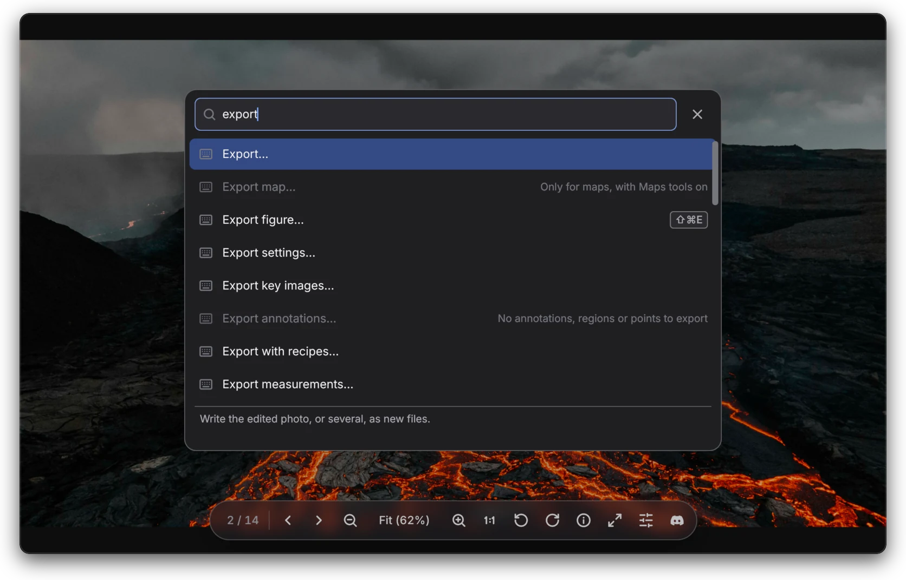
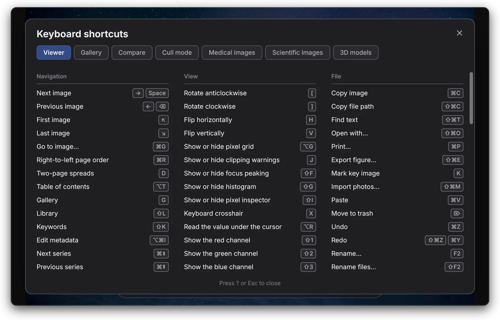
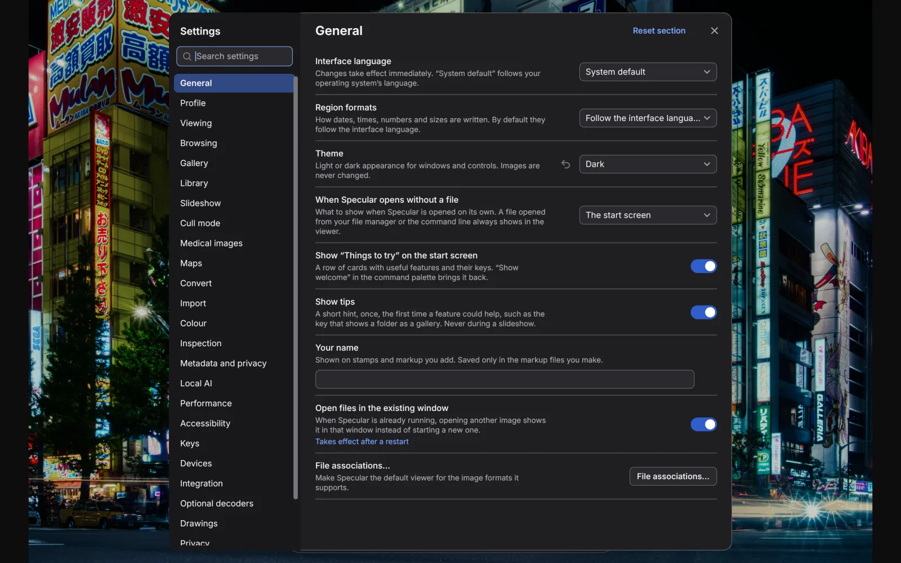
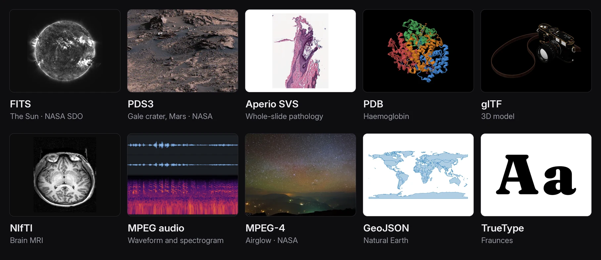

<div align="center">

<a href="https://amazynk.com/specular"></a>

<h1>Specular</h1>

<p>
  A fast, GPU-drawn viewer for photos, camera RAW, HDR, video, audio and 400+ other formats.
  <br>
  Free, open source and offline, on macOS, Windows and Linux.
</p>

<p>
  <a href="#about">About</a>
  ·
  <a href="#download">Download</a>
  ·
  <a href="#documentation">Documentation</a>
  ·
  <a href="CONTRIBUTING.md">Contributing</a>
  ·
  <a href="HACKING.md">Developing</a>
</p>

<p>
  <a href="https://github.com/amazynk/specular/actions/workflows/ci.yml"></a>
  <a href="#license"></a>
  <a href="#formats"></a>
  <a href="https://amazynk.com/discord/"></a>
</p>

</div>

<picture>
  <source media="(prefers-color-scheme: light)" srcset=".github/assets/screenshots/hero-light.webp">
  
</picture>

## About

Specular is a viewer that keeps up with you. The picture is on screen before the file has finished
decoding, a folder flips by as fast as you can press a key, and a whole shoot can be culled,
developed and sent on without leaving the keyboard.

It reads more than 400 formats, from phone photos and camera RAW to telescope frames, DICOM
studies, CAD drawings, 3D models and maps. Most decoders are written in Rust for Specular and built
in, so there are no codec packs to install; the few C and C++ libraries it uses run in a sandboxed
process. There is no account and no telemetry, and nothing leaves your computer unless you ask.

## Features

<table>
<tr>
<td width="50%" valign="top">

<h3>Cull a whole shoot</h3>
Pick, reject, rate 1–5 and colour-label from the keyboard. Group bursts and keep the best frame,
find duplicates, follow a folder while new files land in it, shoot tethered over USB, and print
your picks when you close the window.
</td>
<td width="50%" valign="top">

<h3>First pixel, then every pixel</h3>
An overview shows first, then the tiles nearest your view, then the rest. Large files are
memory-mapped rather than copied, neighbours are decoded ahead, and a still image on screen uses
no CPU.
</td>
</tr>
<tr>
<td width="50%" valign="top">

<h3>A darkroom inside</h3>
Non-destructive RAW development on the GPU: tone, colour grading, masks, retouch, denoise, lens
and perspective correction, and merges to HDR, panorama and focus stack. Edits live in an XMP
sidecar, and the original is never written to.
</td>
<td width="50%" valign="top">

<h3>Every command, one keystroke away</h3>
The command palette finds any command or setting by name and shows its key. Commands that can't
run right now are greyed out, with the reason.
</td>
</tr>
<tr>
<td width="50%" valign="top">

<h3>Made for the keyboard</h3>
A default keymap with cull and viewer layers, presets in the style of Vim, Lightroom and
Photo Mechanic, and every key remappable in <code>keymap.toml</code>.
</td>
<td width="50%" valign="top">

<h3>Quiet by default</h3>
No account and no telemetry. The update check stays off until you turn it on, and AI models
download only when you ask. Light and dark themes, 19 languages, right-to-left layouts and
screen-reader support.
</td>
</tr>
</table>

Also inside:

- **Library:** folders, network shares and removable disks in one catalogue, with albums, smart
  albums, keywords, IPTC editing and local copies of offline originals.
- **Compare:** split, overlay, flicker and difference views, with SSIM and ΔE2000.
- **Export and share:** export recipes, printing, and static client galleries whose picks come back
  as marks. Send picks to your other devices with [Zynk](https://zynk.it).
- **Works with others:** reads the sidecars of darktable, Lightroom, Capture One and digiKam.
- **Scriptable:** a command line, remote control of a running window, and an
  [IPC protocol](docs/ipc.md) with a [Python client](clients/python).

### Beyond photos

Profiles add the tools for one kind of work. They are off until you choose them, so the interface
stays simple if photos are all you open.

| Profile | What it adds |
|---|---|
| **Medical** | DICOM files, folders and discs, NIfTI volumes; window and level, linked series, multi-planar and 3D views, PET/CT fusion, measurements, anonymised export. Viewing only: Specular is not a medical device. |
| **Science** | FITS and XISF with sky coordinates, microscopy and whole-slide images, HDF5 and NetCDF, thermal cameras, spectra; stretches, channel compositing, calibrated measurements. |
| **Engineering** | DXF, PDF drawing sets, HP-GL and Gerber with layers, measuring to scale, markup and revision compare; IFC, STEP and glTF models, point clouds and Gaussian splats. |
| **Maps** | GeoTIFF, shapefiles, GeoPackage, KML, GPX, elevation models and nautical charts, placed on the Earth, with coordinates in many systems. |

**Local AI** is optional and runs on your computer: search by description ("dog on a beach"),
text in images, culling assistance, people, and subject, sky and object masks, denoise, object
removal and depth effects in Develop. Models download only when you ask, and no photo, face or
text they find leaves the computer.

## Formats

<p align="center">
  
</p>

<table align="center">
<tr>
<td align="center"><b>107</b><br>Images and RAW</td>
<td align="center"><b>75</b><br>Science</td>
<td align="center"><b>44</b><br>Maps</td>
<td align="center"><b>38</b><br>3D</td>
<td align="center"><b>37</b><br>Audio</td>
</tr>
<tr>
<td align="center"><b>36</b><br>Documents</td>
<td align="center"><b>29</b><br>Video</td>
<td align="center"><b>22</b><br>CAD</td>
<td align="center"><b>22</b><br>Pathology</td>
<td align="center"><b>15</b><br>Medical</td>
</tr>
</table>

Photos include JPEG, PNG, WebP, HEIC and AVIF, JPEG XL, JPEG 2000, TIFF and PSD, with gain-map HDR
and wide-gamut colour. Camera RAW covers Canon, Nikon (including High Efficiency), Sony, Fujifilm,
Panasonic, Olympus, Pentax, Leica, Hasselblad, Phase One, Sigma and DNG, and counts as one format.
Video includes H.264, HEVC, AV1, VP9, ProRes and ProRes RAW, CineForm and HAP; sound ranges from
FLAC and Opus to tracker modules, MIDI and DSD. DWG, STEP and IGES, Zeiss CZI and Blackmagic RAW
need a library you install yourself. The full list, with every extension, is on
[the website](https://amazynk.com/specular/#formats).

## Speed

<table>
<tr>
<td align="center" width="25%"><h3>130 ms</h3>launch to a 24 MP JPEG on screen, median of cold starts</td>
<td align="center" width="25%"><h3>66 fps</h3>panning a 200 MP JPEG at 100%, with 421 MB peak memory</td>
<td align="center" width="25%"><h3>22.6 ms</h3>to decode a 61 MP lossless Sony RAW on the CPU</td>
<td align="center" width="25%"><h3>0% CPU</h3>while a still image is on screen</td>
</tr>
</table>

<sub>Measured on Linux during 0.1 development, on a laptop with an AMD Radeon 860M. Start-up,
panning and idle figures come from a headless session on a machine busy with other work. The RAW
decode runs on the CPU alone, across all cores. macOS and Windows numbers will follow.</sub>

## Download

> [!IMPORTANT]
> No release has been published yet. Packages will appear on the
> [Releases](https://github.com/amazynk/specular/releases) page and at
> [amazynk.com/specular](https://amazynk.com/specular). Until then, build from source below.

| Platform | Packages | Runs on |
|---|---|---|
| **macOS** | `.dmg`, universal | Apple Silicon and Intel |
| **Windows** | `.msi` installer, portable `.zip` | Windows 10 and 11, x64 |
| **Linux** | AppImage, Flatpak, `.tar.gz` | x86_64, glibc 2.35+, X11 or Wayland |

On x86_64, Specular needs AVX2 (x86-64-v3): Intel Core from Haswell (2013) on, AMD Zen or newer.

### Build from source

You need [Rust](https://rustup.rs) (the pinned toolchain installs itself), a C/C++ compiler and
CMake. Release builds also need NASM.

```sh
git clone https://github.com/amazynk/specular.git && cd specular
./build.sh              # this platform, release → target/dist/<version>/<platform>/
./build.sh --package    # and its packages: .dmg, .msi and .zip, AppImage, Flatpak, .tar.gz
```

If anything is missing, `build.sh` lists all of it at once, with how to install each tool. On
Windows, run it from Git Bash or MSYS2. See [docs/building.md](docs/building.md) for the details.

## Usage

```sh
specular ~/Pictures/Trip-2026                  # open a folder
specular --compare before.tif after.tif        # compare two images
specular --remote open ~/Shoot/_DSC4182.ARW    # open a file in the running window

# Export RAW files for the web without opening a window
specular develop export ~/Shoot/*.ARW --preset web --folder ~/Export

# Cull a file list, then print the picks when you close the window
find ~/Shoot -name '*.ARW' -print0 | specular -0 --print-marked - > picks.txt
```

The built-in manual (<kbd>F1</kbd>) covers every mode, and `specular --help` lists the command line.

<details>
<summary><b>Keyboard</b></summary>
<br>

| Key | Viewer | | Key | Cull mode |
|---|---|---|---|---|
| <kbd>→</kbd> <kbd>Space</kbd> | Next | | <kbd>P</kbd> | Pick |
| <kbd>←</kbd> <kbd>Backspace</kbd> | Previous | | <kbd>X</kbd> | Reject |
| <kbd>F</kbd> | Fit | | <kbd>U</kbd> | Clear flag |
| <kbd>1</kbd>–<kbd>4</kbd> | Zoom to 100–400% | | <kbd>1</kbd>–<kbd>5</kbd> | Rate |
| <kbd>Z</kbd> | Zoom to rectangle | | <kbd>0</kbd> | Clear rating |
| <kbd>Q</kbd> | Loupe | | <kbd>6</kbd>–<kbd>9</kbd> | Red, yellow, green, blue label |
| <kbd>I</kbd> | Info panel | | <kbd>S</kbd> | Group bursts |
| <kbd>G</kbd> | Gallery | | <kbd>B</kbd> | Keep the best of a burst |
| <kbd>J</kbd> | Clipped highlights and shadows | | <kbd>T</kbd> | Follow new files |
| <kbd>Enter</kbd> | Full screen | | <kbd>O</kbd> | Sort by the next quality measure |

On a video, <kbd>P</kbd> or a click on the picture plays and pauses, and <kbd>,</kbd> <kbd>.</kbd>
step one frame.

</details>

<details>
<summary><b>Custom commands</b></summary>
<br>

Bind any program to a key in `settings.toml`. Specular runs it directly with the file (no shell
unless you ask for one) and can reload the image when the program exits.

```toml
[[commands]]
name = "Edit in GIMP"
program = "gimp"
args = ["{file}"]
key = "Ctrl+Shift+G"
reload = true
```

</details>

## Documentation

Using Specular is covered by the manual built into the app. The [docs](docs) folder is for
building on it and working on it:

| Document | What's in it |
|---|---|
| [IPC protocol](docs/ipc.md) · [Python client](clients/python) | Driving Specular from scripts and other programs |
| [XMP sidecars](docs/sidecar-format.md) · [Metadata coverage](docs/metadata-coverage.md) | What is read and written |
| [Develop quality](docs/develop-quality.md) · [DICOM conformance](docs/dicom-conformance.md) | What is measured, and how |
| [Design](docs/DESIGN.md) | Goals, architecture, formats and the rules the code follows |
| [Building](docs/building.md) · [Developing](HACKING.md) | Toolchains, packaging, tests and the repository layout |

## Status

Specular is at version 0.1, before its first public release.

| | Status |
|---|---|
| ✅ Linux, x86_64 | The main development platform |
| ✅ macOS, Apple Silicon | Builds and passes the test suite; speed not yet measured |
| ✅ Windows 10 and 11, x64 | Builds and runs the test suite in CI |
| 🚧 macOS, Intel | Builds; not yet tested on hardware |
| 🚧 Packages | Scripts for every platform are ready; the first release is not out yet |
| 🚧 Translations | 19 languages; some were machine-drafted and await review by native speakers |

Expect rough edges, especially in the specialist profiles. Files that don't open, or open wrong,
are the most useful [reports](https://github.com/amazynk/specular/issues/new/choose).

## Contributing and developing

Questions and ideas go to [Discussions](https://github.com/amazynk/specular/discussions), chat to
[Discord](https://amazynk.com/discord/), and bugs and format requests to
[issues](https://github.com/amazynk/specular/issues/new/choose). Before sending a change, read
[CONTRIBUTING.md](CONTRIBUTING.md); for building, testing and finding your way around the code,
read [HACKING.md](HACKING.md). Please report security problems privately, as described in
[SECURITY.md](SECURITY.md).

## License

Specular is licensed under either of the [Apache License, Version 2.0](LICENSE-APACHE) or the
[MIT License](LICENSE-MIT), at your option. Unless you explicitly state otherwise, any
contribution you intentionally submit for inclusion in Specular, as defined in the Apache-2.0
license, is dual-licensed as above, without any additional terms or conditions.

The third-party software, fonts and data Specular includes keep their own licences, listed in
[packaging/THIRD-PARTY.md](packaging/THIRD-PARTY.md). The photos in the screenshots and the files
in the format wall are credited in [.github/assets/CREDITS.md](.github/assets/CREDITS.md).

<br>

<div align="center">
<sub>Made by the team behind <a href="https://zynk.it">Zynk</a> · <a href="https://amazynk.com">amazynk</a></sub>
</div>
